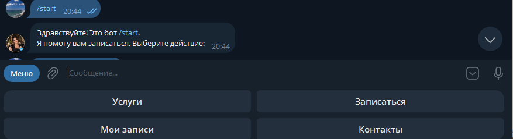
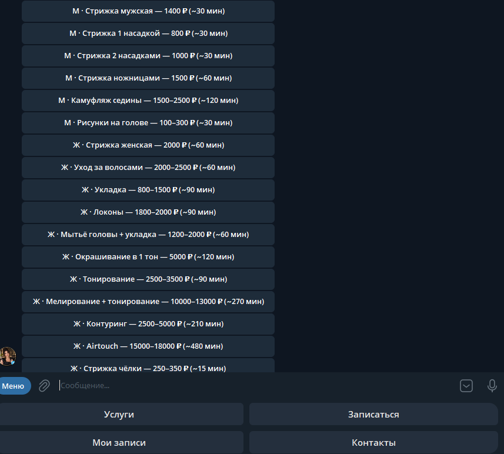
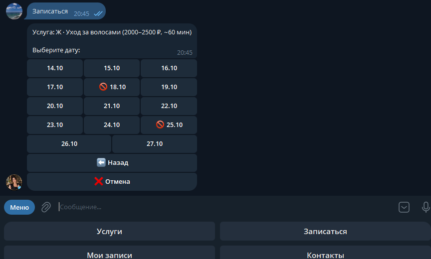
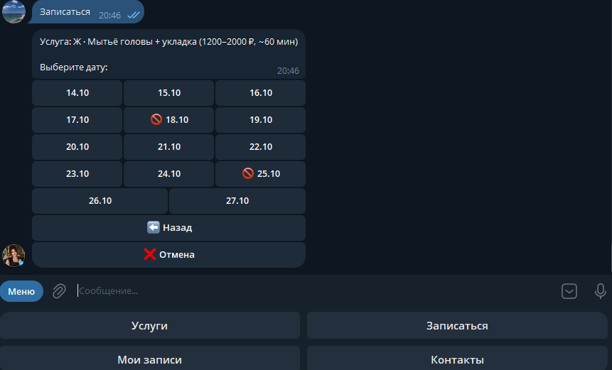
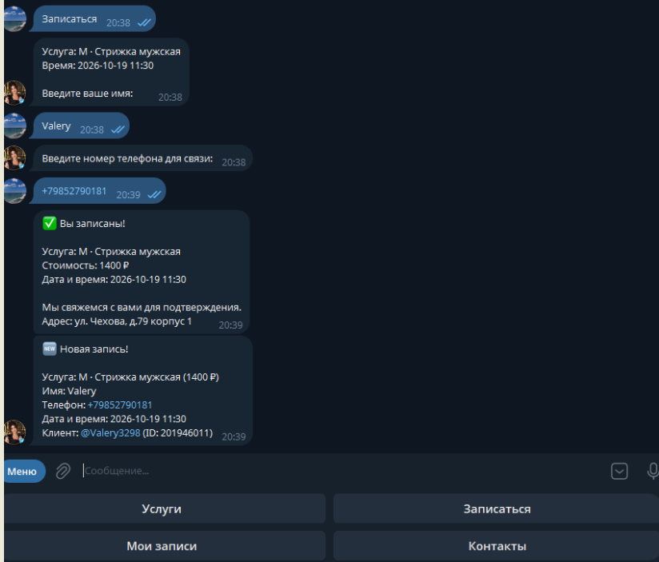
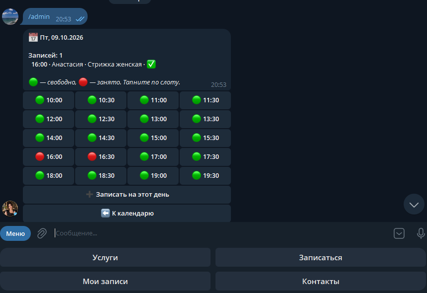
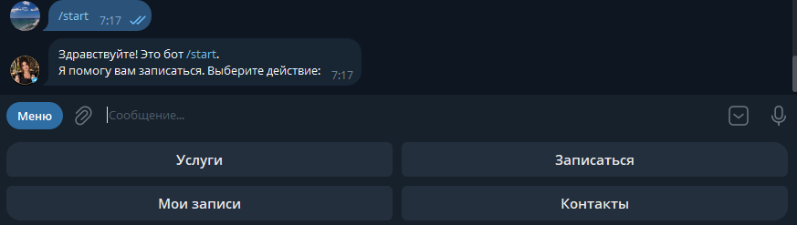

# 💈 Telegram-бот для записи в парикмахерскую

Telegram-бот для онлайн-записи клиентов в салон красоты. Клиент выбирает услугу,
дату и время прямо в чате — администратор получает готовую заявку.
Бот работает 24/7 и разгружает телефон.

Подходит для парикмахерских, барбершопов, салонов красоты, маникюрных кабинетов
и массажных студий — везде, где есть запись по времени.

---

## 📸 Скриншоты
### Клиентский интерфейс

**Главное меню**


**Выбор услуги**


**Календарь**


**Выбор времени**


**Подтверждение записи**


### Админ-панель

**Админ-панель**


### Клиентский интерфейс

| Главное меню | Выбор услуги |
|:---:|:---:|
|  |  |

| Календарь | Выбор времени |
|:---:|:---:|
|  |  |

| Подтверждение записи | Мои записи |
|:---:|:---:|
|  |  |

### Админ-панель

| Главное меню админа | Календарь загрузки |
|:---:|:---:|
|  |  |

| Карточка записи | Управление прайсом |
|:---:|:---:|
|  |  |

> 📁 Все изображения хранятся в `docs/screenshots/`.
> Чтобы добавить новый скриншот — положите файл туда и вставьте строку
> `` в нужное место.

---

## 🚀 Что умеет

### Для клиента
- **Запись за 4 шага:** услуга → дата → время → контакты.
- **Календарь на 14 дней вперёд** с реальными свободными слотами.
- **Гибкие слоты:** шаг 30 минут, занятые слоты скрываются,
  учитывается длительность услуги.
- **Просмотр своих записей** и отмена в один клик.
- **Напоминания:** за день и за час до визита (фоновый поток).

### Для администратора
- **Полноценная админ-панель** (команда `/admin`).
- Просмотр календаря загрузки, подтверждение, отмена и отметка «выполнена».
- Уведомления о новых записях и отменах в реальном времени.
- **Управление прайсом и расписанием** прямо из Telegram
  (изменения сохраняются в `config.json`).
- Запись клиента администратором вручную.
- Поддержка нескольких администраторов одновременно.

---

## 🛠 Стек

- **Python 3.10+**
- **pyTelegramBotAPI (telebot)** — работа с Telegram Bot API.
- **Flask** — приём вебхуков от Telegram (запуск под systemd).
- **SQLite (WAL)** — хранение записей (безопасный `sqlite3 .backup`).
- **Systemd** — продакшн-процесс-менеджер.
- **Nginx + Let's Encrypt** — HTTPS-фронтенд для вебхука.
- **Hostkey.ru (VPS, Ubuntu 22.04)** — хостинг.

---

## 📦 Быстрый старт (локально)

### 1. Клонировать репозиторий

```bash
git clone https://github.com/Djin5926/parik-bot.git
cd parik-bot

2. Виртуальное окружение и зависимости

python -m venv venv

# Windows:
venv\Scripts\activate

# Linux / macOS:
source venv/bin/activate

pip install -r requirements.txt

3. Создать .env в корне проекта
Шаблон — .env.example:

env
BOT_TOKEN=1234567890:AA-your-token-here
ADMIN_IDS=123456789,987654321
WEBHOOK_URL=https://your-domain.com
WEBHOOK_SECRET=change-me-to-random-string
PORT=8080
DB_PATH=barber.db
CONFIG_PATH=config.json
TZ=Europe/Moscow
4. Запуск
bash
python bot.py
Бот автоматически определит режим:

WEBHOOK_URL задан → запустится Flask + вебхук.

WEBHOOK_URL не задан → режим long-polling.

📂 Структура проекта
text
parik-bot/
├── bot.py               # Точка входа: логика бота, Flask, напоминания
├── config.json          # Прайс, расписание, контакты салона
├── .env                 # Секреты (в .gitignore)
├── .env.example         # Шаблон переменных окружения
├── backup_db.sh         # Скрипт бэкапа БД с ротацией
├── barber.db            # База данных SQLite (создаётся автоматически)
├── requirements.txt
├── .gitignore
├── docs/
│   └── screenshots/     # 📸 Скриншоты интерфейса
│       ├── 01-main-menu.png
│       ├── 02-services.png
│       ├── 03-calendar.png
│       ├── 04-time-slots.png
│       ├── 05-confirm.png
│       ├── 06-my-appointments.png
│       ├── 07-admin-panel.png
│       ├── 08-admin-calendar.png
│       ├── 09-appointment-card.png
│       └── 10-price-editor.png
└── README.md
🛡️ Безопасность и эксплуатация (Production)
Проект развёрнут на VPS Hostkey.ru (Ubuntu 22.04) в папке
/home/botuser/parik-bot/ и работает 24/7.

🔐 Безопасность
SSH Hardening.
Вход по паролю для root отключён. Авторизация — только по SSH-ключу
Ed25519 (parik_key.ppk). SSH-порт изменён на 2222 (в UFW открыт только он).

Fail2ban. SSH-джейл защищает от брутфорса.

Секреты. Токен бота, ID админов и WEBHOOK_SECRET вынесены в .env.
Файл в .gitignore, владелец botuser, права 600.

Защита вебхука. Telegram ходит на HTTPS-эндпоинт, дополнительно
защищённый заголовком X-Telegram-Bot-Api-Secret-Token
(значение из WEBHOOK_SECRET). Неавторизованные запросы получают 403 Forbidden.

SSL. Автоматический выпуск и продление сертификатов Let's Encrypt (Certbot).

Сетевая защита. UFW разрешает только порты 2222 (SSH) и 80/443 (Nginx).
Flask слушает только 127.0.0.1:8080 и недоступен из интернета напрямую.

Изоляция. Бот запущен под непривилегированным пользователем botuser
(systemd), что защищает сервер даже при уязвимости в коде бота.

⚙️ Эксплуатация
Systemd. Сервис parikbot.service, автоперезапуск: Restart=always.

Логирование. journald с ограничением SystemMaxUse=500M
(/etc/systemd/journald.conf).

Бэкапы БД. Ежедневно в 03:00 через cron. Скрипт backup_db.sh
использует sqlite3 .backup (безопасная копия «на горячую»), сжимает в gzip,
складывает в /home/botuser/backups/. Ротация — 30 дней.

Таймзона. TZ=Europe/Moscow в .env и Environment=TZ=... в systemd-юните.

🌐 Nginx (кратко)
Nginx принимает HTTPS и проксирует запросы к Flask:

nginx
location /webhook/ {
    proxy_pass http://127.0.0.1:8080;
    proxy_set_header Host $host;
    proxy_set_header X-Real-IP $remote_addr;
    proxy_set_header X-Forwarded-For $proxy_add_x_forwarded_for;
    proxy_set_header X-Forwarded-Proto $scheme;
}
💻 Управление сервером (Workflow)
Для работы с сервером используется WinSCP (протокол SCP, порт 2222).
Авторизация — под root по SSH-ключу parik_key.ppk.

Управление файлами и терминалом — прямо из WinSCP.

Обновить бота
Внести изменения локально (PyCharm).

Через WinSCP перетащить изменённые файлы в /home/botuser/parik-bot/.

В терминале WinSCP (Ctrl+T) перезапустить службу:

bash
sudo systemctl restart parikbot.service
🩺 Диагностика
bash
# Статус службы
sudo systemctl status parikbot.service

# Последние 50 строк лога
sudo journalctl -u parikbot.service -n 50 --no-pager

# Логи Nginx
sudo tail -n 50 /var/log/nginx/access.log
sudo tail -n 50 /var/log/nginx/error.log

# Проверка бэкапов
ls -lh /home/botuser/backups/

# Прослушиваемые порты
sudo ss -tlnp
📄 Лицензия
MIT

👨‍💻 Автор
Валерий — Python-разработчик

Telegram: @Valery3298

GitHub: @Djin5926

Разрабатываю Telegram-ботов и автоматизирую бизнес-процессы под заказ.
Этот проект — бот для салона красоты, работает в продакшене.

text

---

